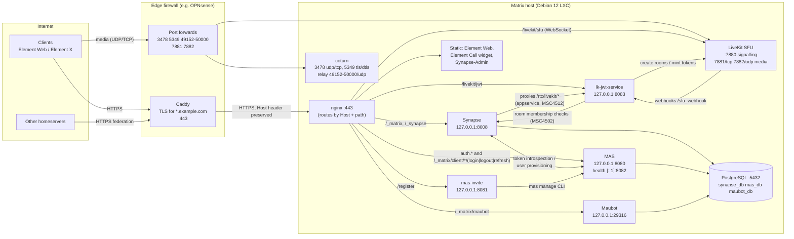

# Architecture

> Docs: [README](../README.md) · [INSTALL](INSTALL.md) · [ARCHITECTURE](ARCHITECTURE.md) · [ADMIN_GUIDE](ADMIN_GUIDE.md) · [AGENTS](../AGENTS.md)

How the stack fits together, which ports and files matter, and how requests flow —
written for troubleshooting. Names use the examples from `setup.config.example`:
homeserver `chat.example.com`, auth `auth.chat.example.com`, this host `192.168.1.100`,
edge proxy `192.168.1.1`.

## Overview



Everything listens on localhost except nginx (80/443), coturn, and LiveKit. TLS from the
internet ends at Caddy; Caddy re-encrypts to nginx (self-signed tolerance, see INSTALL.md),
and nginx uses the same certificate (fetched from the edge by `refresh_certs.sh`).

## Components

| Component | Purpose | Runs as | Installed from | Binary / root | Config |
| :--- | :--- | :--- | :--- | :--- | :--- |
| **Synapse** | Homeserver: rooms, sync, federation, media | `matrix-synapse` | apt `packages.matrix.org` | `/opt/venvs/matrix-synapse` | `/etc/matrix-synapse/homeserver.yaml`, `conf.d/*.yaml` |
| **MAS** | Accounts, passwords, login (OIDC), sessions; provisions users into Synapse | `mas` | GitHub release | `/opt/mas/mas`, `/opt/mas/share` | `/opt/mas/config.yaml` |
| **PostgreSQL** | Databases for Synapse, MAS, Maubot | `postgres` | apt PGDG | `postgresql@<ver>-main` | `/etc/postgresql/<ver>/main/` |
| **nginx** | Routing, TLS to the edge proxy, static files | `www-data` | apt nginx.org (mainline) | — | `/etc/nginx/sites-available/*`, `conf.d/realip.conf`, `snippets/matrix-proxy.conf` |
| **Element Web** | Web client; embeds Element Call | (static) | GitHub release | `/var/www/element-web` | `config.json`, `widgets/element-call/config.json` |
| **Synapse-Admin** | Admin web UI | (static) | GitHub release | `/var/www/synapse-admin` | `config.json` |
| **LiveKit** | SFU for MatrixRTC calls (Element Call / Element X) | `livekit` | GitHub release | `/usr/local/bin/livekit-server` | `/etc/livekit/livekit.yaml` |
| **lk-jwt-service** | MatrixRTC authorization: issues LiveKit tokens for room members | `lk-jwt` | GitHub release | `/usr/local/bin/lk-jwt-service` | env in unit; `/etc/lk-jwt-service/livekit_keys`; appservice `/etc/matrix-synapse/appservices/lk-jwt-service.yaml` |
| **coturn** | TURN/STUN for legacy 1:1 calls | `turnserver` | built from source | `/usr/local/bin/turnserver` (override of Debian unit) | `/etc/turnserver.conf` |
| **Maubot** | Bot framework (admin UI at `/_matrix/maubot`) | `maubot` | pip venv | `/opt/maubot/venv` | `/opt/maubot/config.yaml` |
| **mas-invite** | Web page that mints MAS registration tokens | `mas` | this repo (`mas-invite/`) | `/opt/mas/invite_gen.py` (system python3-flask) | `MAS_PUBLIC_BASE` in unit |

## systemd units

Every long-running component and every scheduled job is a systemd unit; there is no cron.
`install.sh` writes the project's units (see `render_*` in [install.sh](../install.sh);
`./install.sh --render-only DIR` prints them all). Package units come from Debian/upstream.

### Services

| Unit | Source | Runs as | Ordered after | Restart | Key settings |
| :--- | :--- | :--- | :--- | :--- | :--- |
| `postgresql` (`postgresql@<ver>-main`) | PGDG package + drop-in `postgresql@.service.d/restart.conf` | `postgres` | — | on-failure (5 s) | cluster in `/etc/postgresql/<ver>/main/` |
| `matrix-synapse` | matrix.org package + drop-in `matrix-synapse.service.d/matrix.conf` | `matrix-synapse` | postgresql (`Wants=`) | always | reads `homeserver.yaml` + `conf.d/`; `UMask=0027` (logs not world-readable) |
| `mas` | `install.sh` | `mas` | postgresql | always | `MAS_CONFIG=/opt/mas/config.yaml`, cwd `/opt/mas` |
| `mas-invite` | `install.sh` | `mas` | mas | always | `MAS_PUBLIC_BASE=https://auth.<domain>` |
| `livekit` | `install.sh` | `livekit` | network-online | on-failure | `--config /etc/livekit/livekit.yaml` |
| `lk-jwt-service` | `install.sh` | `lk-jwt` | livekit, matrix-synapse | on-failure | all settings as `Environment=` (`LIVEKIT_URL`, `LIVEKIT_KEY_FILE`, `LIVEKIT_JWT_BIND=127.0.0.1:8083`, `LIVEKIT_AS_REGISTRATION_FILE`, ...) |
| `coturn` | Debian unit + `install.sh` drop-in `coturn.service.d/override.conf` | `turnserver` | network | on-failure | drop-in swaps `ExecStart` to the source-built `/usr/local/bin/turnserver` |
| `maubot` | `install.sh` | `maubot` | postgresql, matrix-synapse | always | `/opt/maubot/venv/bin/python -m maubot`, cwd `/opt/maubot` |
| `nginx` | nginx.org package + drop-in `nginx.service.d/restart.conf` | `root` → `www-data` workers | network | on-failure (5 s) | `nginx -t` before every reload |

`After=` only orders startup; nothing hard-`Requires` another unit, so a dependency
restarting does not take its dependents down. The drop-ins above are written by
`install.sh` (`render_system`) and survive package upgrades. Restart `mas` before `matrix-synapse` when
both changed (Synapse checks MAS at startup).

### Scheduled jobs (timers)

Each job is a `Type=oneshot` service running a repo script as root, plus a `.timer`. Output is
appended to a file in `/var/log/` (and failures show in `systemctl --failed`).

| Timer | Runs | Schedule | Log | Enabled by default |
| :--- | :--- | :--- | :--- | :--- |
| `matrix-turn-ip.timer` | `update_turn_ip.sh` | every 30 s (and 30 s after boot); a change is applied once two runs agree | `update_turn_ip.log` | yes |
| `matrix-monitor.timer` | `monitor_services.sh` | every 5 min (`*:0/5`) | `matrix_monitor.log` | yes |
| `matrix-refresh-certs.timer` | `refresh_certs.sh` | 00:00 daily, 2 min after boot; catches up missed runs | `refresh_certs.log` | yes |
| `matrix-backup.timer` | `backup_matrix.sh` (`Nice=10`, idle I/O, 4 h limit) → `BACKUP_DIR` | 03:30 daily; catches up missed runs | `matrix_backup.log` | **no** — `systemctl enable --now matrix-backup.timer` |

```bash
systemctl list-timers 'matrix-*'            # last / next run of every job
systemctl start matrix-monitor.service      # run a job now
systemctl status matrix-refresh-certs.service   # result of the last run
```

`monitor_services.sh` checks that the timers are active and that no unit is in the failed
state, so a job that stops running *or* fails raises an alert (details in
[ADMIN_GUIDE → Monitoring](ADMIN_GUIDE.md#monitoring)). Job logs are rotated by
`/etc/logrotate.d/matrix-jobs`.

## Ports

| Port | Proto | Bound to | Service | Exposed to internet? |
| :--- | :--- | :--- | :--- | :--- |
| 443 | tcp | all | nginx (`chat.`, `auth.`) | via Caddy (edge :443) |
| 80 | tcp | all | nginx → 301 to HTTPS | no (LAN only) |
| 8008 | tcp | 127.0.0.1 | Synapse client + federation API | via nginx |
| 8080 | tcp | 127.0.0.1 | MAS (web, OAuth, compat, GraphQL) | via nginx |
| 8082 | tcp | ::1 | MAS health | no |
| 8081 | tcp | 127.0.0.1 | mas-invite | via nginx `/register` (Caddy adds auth) |
| 8083 | tcp | 127.0.0.1 | lk-jwt-service | via Synapse proxy and nginx `/livekit/jwt/` |
| 29316 | tcp | 127.0.0.1 | Maubot | via nginx (Caddy: private IPs only) |
| 5432 | tcp | localhost | PostgreSQL | no |
| 7880 | tcp | all | LiveKit signalling (WebSocket) | via nginx `/livekit/sfu/` |
| **7881** | tcp | all | LiveKit ICE/TCP media | **port-forward** |
| **7882** | udp | LAN IP | LiveKit media (UDP mux) | **port-forward** |
| **3478** | udp+tcp | LAN IP, 127.0.0.1 | coturn STUN/TURN | **port-forward** |
| **5349** | tcp+udp | LAN IP, 127.0.0.1 | coturn TURN over TLS / DTLS | **port-forward** |
| **49152–50000** | udp | LAN IP | coturn relay range | **port-forward** |
| 25 | tcp | localhost | postfix (Debian default, unused by the stack) | no |

## Request flows

**Discovery.** A client resolves `https://chat.example.com/.well-known/matrix/client`
(served by nginx, contains only `m.homeserver`), then reads
`/_matrix/client/v1/auth_metadata` (Synapse) to find MAS at `auth.chat.example.com`.
Federation peers read `/.well-known/matrix/server` → `chat.example.com:443`.

**Login (OAuth / Element X, current Element Web).** Client → MAS (`auth.`) authorization
flow → MAS issues an access token. On every API call Synapse **introspects** the token
against MAS (`matrix_authentication_service.endpoint`, shared `secret`).
*Legacy password login* (`/_matrix/client/*/login`, `logout`, `refresh` — e.g. Synapse-Admin)
is routed by nginx straight to MAS's compatibility layer. Synapse-Admin still calls `r0`
paths; nginx rewrites `r0` → `v3`.

**Account provisioning.** MAS owns users. When a user is created/locked/deactivated in MAS,
MAS calls Synapse's `/_synapse/mas/*` endpoints (localhost) to mirror it. If that fails,
MAS logs `Job failed, will retry` and Synapse logs errors on `MasProvisionUserResource`;
`manage_users.py list` shows the user as `IN-SYNAPSE no!`.

**Federation.** Other servers → Caddy → nginx `/_matrix/federation`, `/_matrix/key` → Synapse.
Synapse fetches remote signing keys directly (`trusted_key_servers: []`).

**MatrixRTC call (Element Call / Element X — all calls in this deployment).**
1. Client asks Synapse `GET /_matrix/client/v1/rtc/transports` → `m.livekit` at
   `wss://chat.example.com/livekit/sfu`.
2. Client `POST /_matrix/client/v1/rtc/livekit/get_token`. Synapse proxies it (MSC4512) to
   lk-jwt-service, which is registered as an **application service**.
3. lk-jwt-service checks the user is joined to the room (MSC4502 query to Synapse), creates
   the LiveKit room if needed (`room.auto_create: false` on the SFU), and returns a JWT.
4. Client opens the WebSocket to LiveKit through nginx and sends media to the public IP on
   **7882/udp** (fallback **7881/tcp**). LiveKit learns the public IP via STUN at startup.
5. LiveKit webhooks tell lk-jwt-service when participants disconnect, so it can fire the
   user's delayed "leave" event (MSC4140).
Membership uses sticky events (MSC4354, `matrix_rtc_mode: matrix_2_0`).

**Legacy 1:1 call (other clients).** Client gets HMAC TURN credentials from Synapse
(`/_matrix/client/v3/voip/turnServer`, signed with `turn_shared_secret`), then relays
via coturn at the public IP; coturn advertises `external-ip=<public>/<LAN>`.

## Trust boundaries & client IPs

* Caddy sets `X-Forwarded-For`. nginx trusts it **only** from `EDGE_PROXY_IP` and
  localhost (`conf.d/realip.conf`), so `$remote_addr` is the real client. nginx passes that
  to Synapse (`x_forwarded: true`) and MAS (`trusted_proxies: 127.0.0.1/8, ::1/128`).
* Admin surfaces are restricted at the edge (Caddy): `/_synapse/admin*`, `/synapse-admin*`,
  `/_matrix/maubot*` → private IPs only; `/register` → Caddy authentication.
* coturn refuses to relay to private/reserved ranges (`denied-peer-ip`), except itself.
* Synapse URL previews refuse private/reserved ranges (`url_preview_ip_range_blacklist`).

## Secrets map

| Secret | Lives in | Shared with |
| :--- | :--- | :--- |
| `matrix_authentication_service.secret` | `homeserver.yaml` | MAS `matrix.secret` (must match) |
| `turn_shared_secret` | `homeserver.yaml` | coturn `static-auth-secret` (must match) |
| `registration_shared_secret` | `conf.d/registration.yaml` | — |
| appservice `as_token` / `hs_token` | `appservices/lk-jwt-service.yaml` | read by Synapse and lk-jwt-service |
| LiveKit API key/secret | `/etc/livekit/livekit.yaml` | `/etc/lk-jwt-service/livekit_keys` (must match) |
| DB passwords | `homeserver.yaml`, MAS `database.uri`, Maubot `database` | PostgreSQL roles |
| MAS signing keys / encryption key | MAS `secrets` | — (generated by `mas config generate`) |
| SMTP password | `conf.d/email.yaml`, MAS `email.password` | mail provider |
| Maubot admin password, `unshared_secret`, pickle key | `/opt/maubot/config.yaml` | — |

All of these files are mode 600/640 and owned by the service that reads them.

## Troubleshooting by symptom

| Symptom | Likely cause | Check |
| :--- | :--- | :--- |
| Synapse restarts in a loop after an upgrade | Removed/renamed config option | `journalctl -u matrix-synapse -n 30` → `Error in configuration at ...`; read the Synapse upgrade notes |
| `chat.` returns the MAS "Page not found", `/_matrix/*` 404 | Edge proxy not sending the original `Host` | nginx access log; ensure Caddy `header_up Host {host}` and that Caddy reloaded |
| Everyone's IP is the edge proxy's in logs | `realip` not trusting the proxy | `/etc/nginx/conf.d/realip.conf` `set_real_ip_from` = edge IP |
| Login works, users get logged out later | `refresh` not reaching MAS | nginx `location ~ ^/_matrix/client/[^/]+/(login\|logout\|refresh)$` |
| `MasProvisionUserResource` errors / MAS "Job failed, will retry" | User half-exists in Synapse | `./manage_users.py list` (`IN-SYNAPSE no!`); homeserver.log traceback |
| Calls: join works, no audio/video | Media ports or public IP | Forwards for 7881/tcp, 7882/udp; `journalctl -u livekit \| grep "external IP"` should say `using external IPs <public>/<LAN>` |
| Calls: "failed to get token" | lk-jwt-service / appservice wiring | `journalctl -u lk-jwt-service`; `curl -s 127.0.0.1:8083/healthz`; `matrix_rtc` + `msc4502/4512` flags in Synapse |
| Legacy calls relay `127.0.0.1` or fail across NAT | coturn `relay-ip`/`external-ip` | `grep -E 'relay-ip|external-ip' /etc/turnserver.conf`; `update_turn_ip.sh` log |
| All calls fail right after an ISP IP change | coturn/LiveKit still advertising the old IP | `systemctl list-timers matrix-turn-ip.timer`; `/var/log/update_turn_ip.log`; `systemctl start matrix-turn-ip.service` |
| Browser cert warning on LAN, coturn TLS fails | Expired cert from the edge | `/var/log/refresh_certs.log`; `openssl x509 -enddate -in /etc/nginx/ssl/matrix.crt` |
| Google sign-in "redirect_uri_mismatch" | Callback URL vs provider ULID | MAS sends `https://auth.../upstream/callback/<provider id as MAS normalises it>` — copy it from MAS, not from config |
| Monitor alert | Service down or endpoint failing | `journalctl -u <service> -n 50`; `/var/log/matrix_monitor.log` |

Useful one-liners:

```bash
systemctl --failed
for s in matrix-synapse mas mas-invite livekit lk-jwt-service coturn maubot nginx postgresql; do printf '%-16s %s\n' $s "$(systemctl is-active $s)"; done
curl -s localhost:8008/health; curl -s '[::1]:8082/health'; curl -s 127.0.0.1:8083/healthz
tail -f /var/log/matrix-synapse/homeserver.log
journalctl -u mas -u lk-jwt-service -u livekit -f
```
